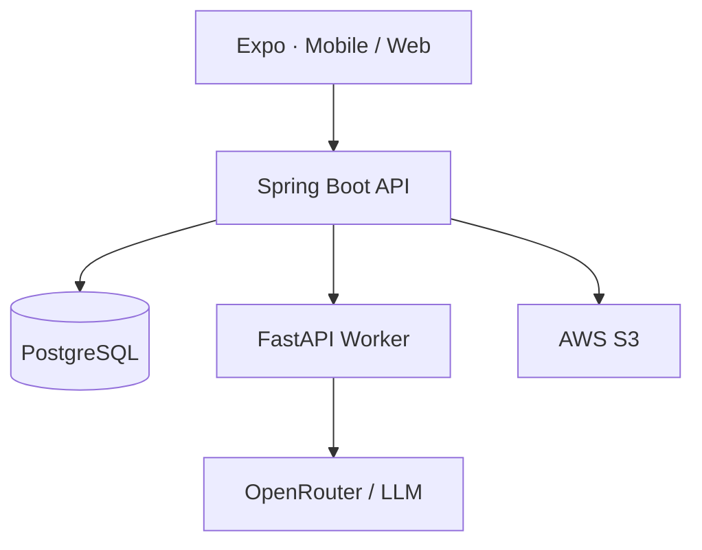

<div align="center">


# Grow Together

**Every little moment, growing together.**

A parenting companion for planning small activities, keeping everyday memories,<br />
and making room for meaningful moments together.

같이 키우기 · Built for parents and caregivers.

[](#roadmap)
[](apps/mobile/package.json)
[](apps/api/build.gradle)
[](apps/worker/pyproject.toml)

[Overview](#overview) · [Features](#key-features) · [Architecture](#architecture) · [Getting Started](#getting-started) · [Roadmap](#roadmap)

</div>

## Overview

Grow Together brings the small, easily forgotten parts of parenting into one place:
an activity to try, a reaction worth remembering, and a few words about the day.
The mobile-first app supports iOS, Android, and the web with a shared React Native
interface and a warm, restrained visual style.

AI-assisted schedule generation helps turn available time into activities to
review and choose from. Caregivers stay in control of what gets saved. The backend
also implements weekly summaries and AI reflections; the mobile report screen is
still awaiting integration. Suggestions are not medical or developmental advice.

This repository is under development. A screen or Worker endpoint does not imply
that its entire product flow is connected; the boundaries below describe the
current implementation.

## Key Features

**Daily planning**

Browse a week, add or edit activities, switch between time and task views, and
mark activities complete. Record a child's reaction to a completed activity.

**Parenting diary**

Write, edit, and revisit dated entries linked to activities. Explore records by
date or in a collected view, with separate handling for loading, empty, and error states.

**Child and caregiver profiles**

Manage one child profile per account, including birthday and personalization
inputs. View and edit the caregiver's name through the existing account flow.
Shared-family accounts and multiple child profiles are not implemented.

**AI schedule generation**

Generate activity candidates through the API and Worker, inspect the proposed
times, and save a selected set. Recorded activity reactions can inform later suggestions.

**Local photo preview**

In the labeled preview mode, attach up to three photos and open them in a viewer.
Authenticated diary editing can retain or remove existing server image references;
adding new photos through the mobile upload flow is not connected yet.

**Foundations for reflection and conversation**

Weekly report aggregation and AI generation exist in the API and Worker. The mobile
report view is a presentation foundation, not a connected report experience.
The chat UI keeps local session messages without producing AI replies, and diary
writing assistance currently composes text locally. Worker chat and diary generators
exist separately; their mobile/API integration remains outstanding.

## Tech Stack

| Layer                    | Technologies                                                                                  |
| ------------------------ | --------------------------------------------------------------------------------------------- |
| Mobile & web             | Expo SDK 55, React Native 0.83, TypeScript, Expo Router, TanStack Query, Reanimated           |
| Backend API              | Java 21, Spring Boot 4, Spring Security, JPA, Flyway                                          |
| AI Worker                | Python 3.12+, FastAPI, Pydantic, uv, OpenRouter                                               |
| Database                 | PostgreSQL 16; local Compose uses a pgvector-enabled image                                    |
| File storage             | AWS S3 with API-issued signed URLs and upload-completion checks                               |
| Admin prototype          | Next.js App Router, React, Tailwind CSS, shadcn/ui, Recharts; mock data only                  |
| Development & deployment | Docker Compose, Gradle, npm; Vercel static-web configuration and Render staging documentation |

The storage API exists independently of the unfinished mobile photo-upload flow.
The Admin console has no real authentication or production API connection.
Provider deployment settings and live service availability are not established by
this README.

## Architecture



The API owns authentication, account scoping, persistence, and the external
[OpenAPI contract](contracts/openapi.yaml). The Worker accepts authenticated
internal generation requests and does not query the application database directly.
The mobile app never receives the Worker service key or the LLM provider key.

The default Compose stack runs PostgreSQL and the API. Enable the optional
`worker` profile for connected schedule and report generation. Internal chat and
diary routes are not shown as connected product flows in the diagram.

## Getting Started

### Prerequisites

- Node.js **20.19.4+** and npm for the mobile app; the optional Admin requires **22.18+**.
- Docker with Docker Compose for the local database and API.
- OpenSSL to generate local signing and service keys.
- Java **21** for API development outside Docker.
- Python **3.12+** and [uv](https://docs.astral.sh/uv/) for Worker development outside Docker.

### Clone and configure

```bash
git clone https://github.com/LYJ0304/grow-together.git
cd grow-together
cp infra/.env.example infra/.env
cp apps/api/.env.example apps/api/.env
cp apps/mobile/.env.example apps/mobile/.env
cp apps/worker/.env.example apps/worker/.env
openssl rand -base64 32
```

Put the generated value in `JWT_SECRET` in `apps/api/.env`. Keep every `.env`
local. Use the templates as the configuration reference, not as production credentials.

For AI generation, set the same nonempty `AI_WORKER_API_KEY` in the API and Worker
files. Configure `OPENROUTER_API_KEY`, `LLM_DIARY_MODEL`, and `LLM_CHAT_MODEL` only in
the Worker. Optional schedule/report model settings fall back to the diary model.
The service key and provider key are different credentials; neither belongs in
`EXPO_PUBLIC_*` variables. S3 file operations require a configured bucket and AWS credentials.

### Backend API and database

From the repository root:

```bash
docker compose --env-file infra/.env -f infra/compose.yaml up --build
```

The API listens at `http://localhost:8080`; explore its contract at
`http://localhost:8080/swagger-ui.html`. Flyway runs migrations on API startup.
The default stack supports core account, diary, and activity APIs without starting
the Worker. AI generation needs the additional service below.

### AI Worker

To start the API, database, and Worker together, use this command instead:

```bash
docker compose --env-file infra/.env -f infra/compose.yaml --profile worker up --build
```

Compose exposes Worker port `8000` only to its internal network. For a standalone
host process, configure its `.env`, then run:

```bash
cd apps/worker
uv sync --locked
uv run uvicorn app.main:app --host 0.0.0.0 --port 8000
```

A host API must load its environment explicitly and use a reachable database and
`WORKER_BASE_URL`; see the [development guide](docs/development.md).

### Mobile application

In another terminal:

```bash
cd apps/mobile
npm ci
npm start
# Or: npm run web
```

For a physical phone, replace `localhost` in `EXPO_PUBLIC_API_URL` with your
computer's LAN address. Expo normally uses port `8081`; keep browser origins in
`CORS_ALLOWED_ORIGINS` consistent with the port you actually use.

Set `EXPO_PUBLIC_ENABLE_AUTH_BYPASS=false` when testing real authentication.
Labeled UI preview is available in development/staging and never grants protected
API access. Production always disables that bypass.

### Optional Admin demo

```bash
cd apps/admin
npm ci
npm run dev
```

Open `http://localhost:3001`. This is a frontend-only demo: Mock login, metrics,
account actions, and settings do not authenticate administrators or change real data.

Environment-variable tables, test commands, host-process setup, and release notes
are in the [development reference](docs/development.md).

## Project Structure

```text
apps/
  mobile/          Expo client, shared native/web UI, tests, and mobile docs
  api/             Spring Boot domain API, persistence, and API docs
  worker/          FastAPI generation services and independent Worker tests
  admin/           Standalone Next.js admin demo
contracts/         External OpenAPI contract
infra/             Local Compose, PostgreSQL initialization, and setup docs
docs/              Cross-project documentation
.harness/          Development conventions and repository skills
.agents/skills/    Codex links to the repository skills
```

## Roadmap

Status describes code in this repository, not deployment or release certification.

### Completed

- [x] Account authentication and caregiver profile editing.
- [x] Single-child profile registration and personalization inputs.
- [x] Dated diary CRUD and activity management with recorded reactions.
- [x] Review-and-save AI schedule generation through the API and Worker.
- [x] Weekly report API aggregation and internal AI generation.
- [x] Local photo-preview UI and a standalone mock Admin console.

### In Progress

Partial implementations with integration still outstanding:

- [ ] Connect the mobile report presentation to the weekly report API.
- [ ] Connect local chat and diary-assistance UIs to the existing Worker generators
      through an authenticated API flow.
- [ ] Connect mobile photo selection to signed uploads and diary attachment persistence.
- [ ] Add real Admin authentication, authorization, and operational API integration.

### Planned

Follow-up candidates, not available product features:

- [ ] Notifications and shared-family workflows, including multiple child profiles.
- [ ] A consistent Home / Diary / Schedule / Chat screenshot gallery from the app.

## License

No repository-wide `LICENSE` file is currently provided. Do not assume an MIT or
other open-source license applies to this project. Third-party notices, including
the [shadcn/ui MIT notice](apps/admin/SHADCN-LICENSE.md), apply to their respective
components and do not license the repository as a whole.
